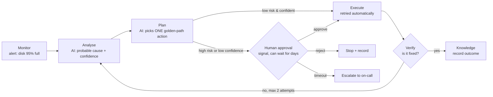

# AI Self-Healing Incidents with Temporal

A small proof of concept that combines **Temporal** (deterministic, durable workflows) with **AI agents** (non-deterministic reasoning) to handle ifrastructure incidents through the **MAPE-K loop**: Monitor → Analyse → Plan → Execute, plus Knowledge. A **human approves** risky actions.

Temporal orchestrates the whole process and keeps its state. The AI is only called for the steps that need judgement: diagnosing the problem and proposing a fix.

**Timeline:** the AI cleans logs, re-plans, waits for human approval, then expands the disk.

**Audit trail:** the approval is recorded with who approved it.

**Human in the loop:**


## How it works



| Step | Who does it | Temporal feature used |
|---|---|---|
| Monitor | Alert starts a workflow | Workflow start |
| Analyse | AI (LLM) | Activity with retries and timeout |
| Plan | AI, restricted to an approved list of actions | Activity, plus a guardrail in code |
| Approve | Human | **Signal** and `wait_condition` with timeout; waiting costs nothing |
| Execute | Automation | Activity with retry policy; only this step is retried |
| Verify | Automation | Activity; loops back to Analyse if not fixed |
| Knowledge | Automation | Outcome and prompt version recorded; full history in Temporal |

## Design choices

- **The AI never runs commands directly.** It can only choose from a list of approved actions (`ALLOWED_ACTIONS` in `shared.py`), like golden paths. Anything else is refused and sent to a human.
- **Risk-based approval.** Low-risk actions such as cleaning logs or restarting a service run automatically. High-risk ones such as expanding a disk, rebooting a VM or scaling pods wait for a human. So do any actions where the AI's confidence is below 0.6.
- **Long waits are free.** A workflow can wait hours or days for approval without the AI keeping any context in memory, because Temporal stores the state.
- **Crash-proof.** If the worker crashes mid-incident, the workflow resumes at the exact step where it stopped. Earlier AI calls are not repeated.
- **Auditable.** Every AI proposal, approval and action is in the Temporal history. The prompt version is recorded with every run, so you can tell which prompt produced which decision.
- **Consistent AI output.** Prompts are versioned (`PROMPTS` in `llm.py`), and v2 forces structured JSON output.

## Run it

Requirements: Python 3.10+ and the [Temporal CLI](https://docs.temporal.io/cli).

```bash
pip install -r requirements.txt

# Terminal 1: local Temporal server (web UI at http://localhost:8233)
temporal server start-dev

# Terminal 2: the worker
python worker.py

# Terminal 3: trigger incidents
python trigger.py disk_full            # fixed automatically (clean logs)
python trigger.py service_crash        # fixed automatically (restart)
python trigger.py disk_full_stubborn   # cleaning logs isn't enough -> AI re-plans -> asks for approval
python trigger.py pod_crashloop        # scale out -> asks for approval
python trigger.py database_growth --timeout 1   # nobody approves within 1 min -> escalation
```

When a workflow is waiting:

```bash
python status.py <workflow_id>                       # what is it waiting for?
python approve.py <workflow_id> --by Abhisha         # approve
python approve.py <workflow_id> --reject --by Abhisha --comment "peak hours"
```

By default the AI is **mocked**, so the demo runs with no API key. To use a real LLM, set any OpenAI-compatible endpoint, for example Mistral, OpenAI or a local Ollama model:

```bash
export LLM_API_KEY=...
export LLM_BASE_URL=https://api.mistral.ai/v1
export LLM_MODEL=mistral-small-latest
```

## Demo: crash resilience

```bash
STEP_DELAY=4 python worker.py          # slow each step down so you have time
python trigger.py disk_full_stubborn
# while it says "planning" or "executing": press Ctrl+C on the worker, then restart it
python worker.py
# the workflow continues from the same step, and the AI is not called again
```

You can also stop the worker while a workflow waits for approval, approve it, then start the worker again. Temporal stores the signal, and the workflow continues once the worker is back.

Other options:

- `FLAKY=1 python worker.py` makes the first infrastructure call fail. Watch Temporal retry only that step.
- Open http://localhost:8233 to see each incident's full event history.

## Files

| File | Purpose |
|---|---|
| `workflows.py` | The MAPE-K workflow: loop, approval signal, status query, escalation |
| `activities.py` | AI steps, simulated infrastructure actions, verification, knowledge |
| `llm.py` | Versioned prompts; real LLM or mock |
| `shared.py` | Data types, approved actions and their risk levels |
| `trigger.py` | Monitor: simulates alerts and starts workflows |
| `approve.py`, `status.py` | Human-in-the-loop tools |

## Limitations and next steps

- Infrastructure is simulated (`infra_state.json`). A real version would call cloud or Kubernetes APIs, or the platform's existing automation.
- Approval is done from the command line. It could be a button in Teams or Slack, or in Backstage.
- Could add: one Temporal workflow coordinating several specialised agents (diagnosis, cost, security), similar incidents retrieved from the knowledge file to improve diagnoses, and evaluation of prompt versions on replayed incidents.
